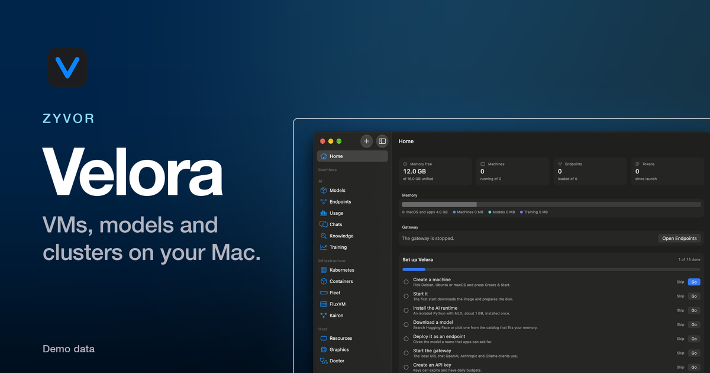
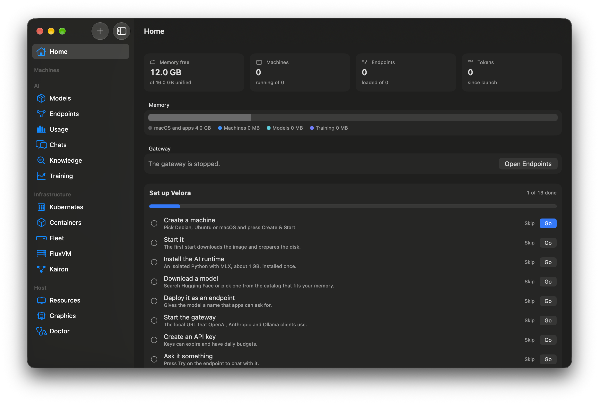
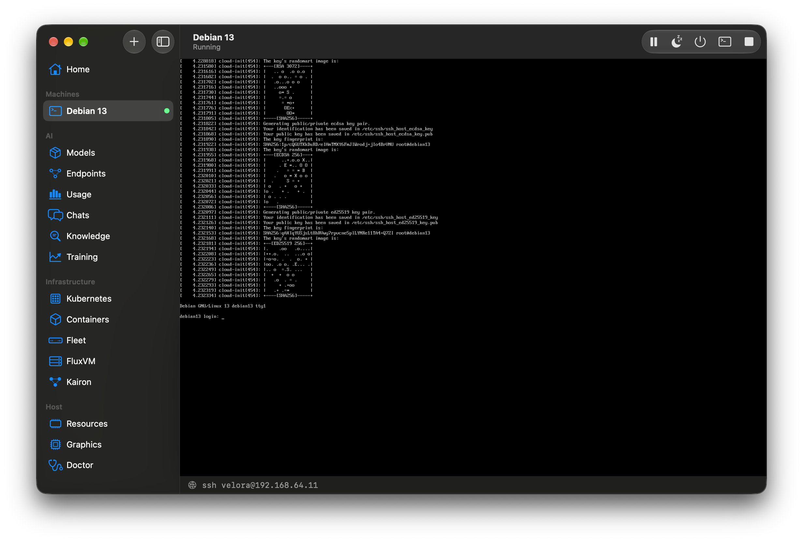
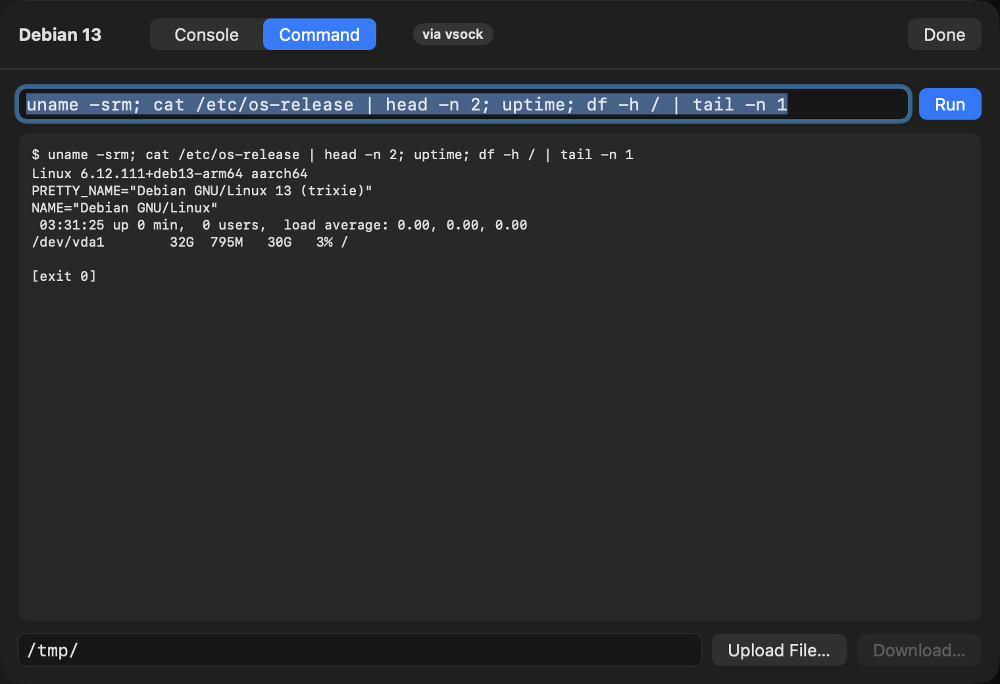
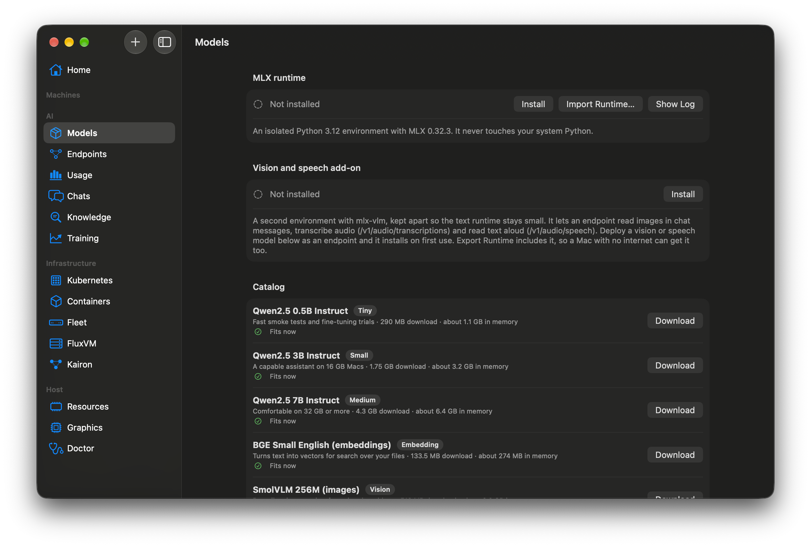
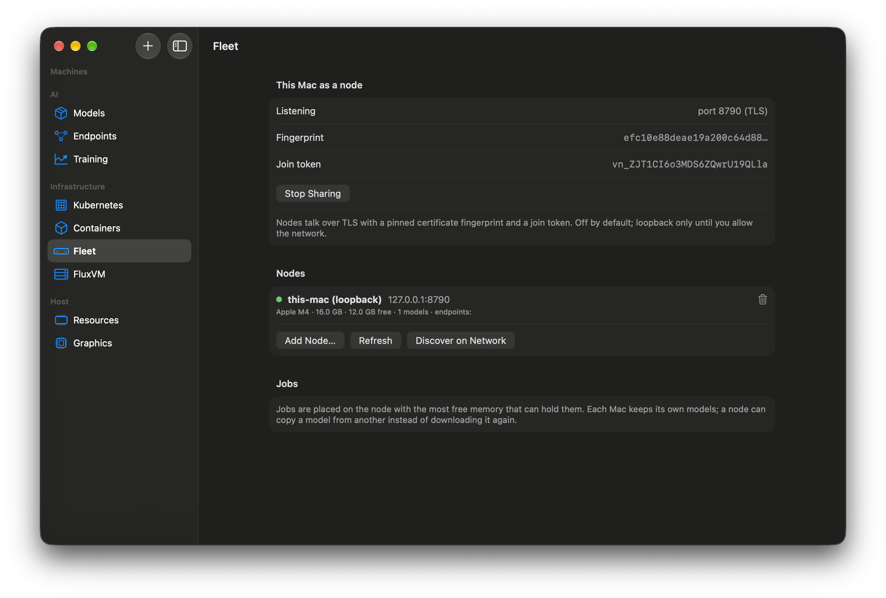
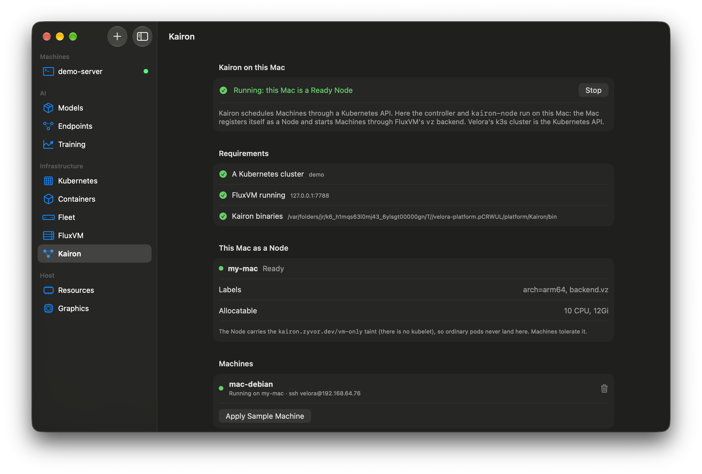

<div align="center">



# Velora

**VMs, models and clusters on your Mac.**

Debian, Ubuntu and macOS virtual machines, local MLX models, Kubernetes, FluxVM and Kairon, in one native app for Apple silicon.

[Website](https://zyvorai.github.io/velora/) · [Download v0.4.4](https://github.com/zyvorai/velora/releases/tag/v0.4.4) · [Tutorials](docs/tutorials/README.md) · [Docs](docs/)

</div>

## Download the 30-day trial

| | |
| --- | --- |
| **[Velora-0.4.4.dmg](https://github.com/zyvorai/velora/releases/download/v0.4.4/Velora-0.4.4.dmg)** | Drag Velora to Applications. Signed with our Developer ID and notarized by Apple. |
| Release page | [v0.4.4](https://github.com/zyvorai/velora/releases/tag/v0.4.4) · [`.sha256`](https://github.com/zyvorai/velora/releases/download/v0.4.4/Velora-0.4.4.dmg.sha256) |
| SHA-256 | `93589a2568e6facc70f6b6aac7526472f10c205f64e1931ae1d0629abc4c6312` |

The app runs without a key. For a free 30-day trial key, email **sales@zyvor.dev**. Requires macOS 26 or later on Apple silicon.

Or install with Homebrew:

```bash
brew install --cask zyvorai/tap/velora
```

Verify a download:

```bash
cd ~/Downloads && shasum -a 256 -c Velora-0.4.4.dmg.sha256
```

## Screenshots

Demo data.

| | |
| --- | --- |
|  |  |
|  |  |
|  |  |

Light and dark captures of every pane are in [`docs/ux/`](docs/ux/).

## Features

- **Machines:** boot Debian, Ubuntu or macOS in one click on Apple's Virtualization framework. Snapshots and restore, clones with a fresh identity, suspend and resume, shared folders, Rosetta, port forwards on `127.0.0.1`.
- **Console & Command:** a live serial console, a command box with exit codes, and file upload and download, through a small guest agent on virtio-vsock.
- **Models and endpoints:** MLX models on your GPU behind an OpenAI-compatible gateway with keys, versions and rollback. Nothing leaves your Mac.
- **LoRA fine-tuning:** checkpoint, pause, resume and yield to inference.
- **Kubernetes:** k3s clusters of Velora Ubuntu VMs. Verified for a single node; multi-node join is not verified.
- **FluxVM and Kairon:** FluxVM images, snapshots and clones from the app; Kairon registers this Mac as a Kubernetes Node.
- **Fleet:** a card per Mac with memory, heat, disk, Thunderbolt links and RDMA.

## Requirements

- Apple silicon Mac (M1 or newer). Intel Macs are not supported.
- macOS 26 or later.
- About 10 GB free disk for a Linux guest, about 17 GB more for a macOS guest.

## Trial and licence

- The app is under the Business Source License 1.1 ([LICENSE-APP.txt](LICENSE-APP.txt)): free for personal, home, learning and non-production use. Plain words: [LICENSING.md](LICENSING.md).
- A free 30-day trial key is available from sales@zyvor.dev. The trial is a soft trial: nothing is disabled and no data is lost when it ends.
- Production business use needs **Velora Pro: INR 7,299 per Mac per year incl. 18% GST in India (about US$74 excl. tax outside India)**. [Buy Velora Pro](https://zyvor.dev/buy#velora) (or the [payment page](https://rzp.io/rzp/cjooj55V)); start with the free 30-day trial above. Prices: INR incl. 18% GST in India; US dollars excl. tax elsewhere (VAT, GST or sales tax added where applicable). Pay online by UPI, card or netbanking; international cards work (charged in rupees); or request a US-dollar invoice by bank transfer. Custom pricing: contact sales@zyvor.dev. Fleet and Enterprise: sales@zyvor.dev.
- macOS guests are licensed by Apple, not by Velora: [MACOS-LICENSING.md](MACOS-LICENSING.md).
- This website and documentation are Copyright 2026 Zyvor AI Labs, all rights reserved ([LICENSE](LICENSE)).

## Docs

[Install guide](docs/INSTALL.md) · [Tutorials](docs/tutorials/README.md) · [How it works](docs/how-it-works.md) · [FluxVM](docs/fluxvm.md) · [Kairon](docs/kairon.md) · [Kubernetes](docs/kubernetes.md) · [What is verified](docs/RELEASE.md) · [Client overview (PDF)](docs/Velora-Client-Overview.pdf) · [Security](SECURITY.md)

Report a problem: [open an issue](https://github.com/zyvorai/velora/issues/new?template=bug_report.md) with your Mac model, macOS version and Velora version.

The Velora source code is private.
